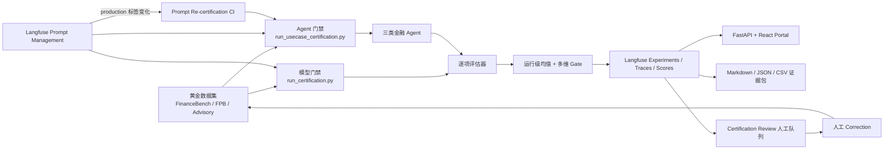
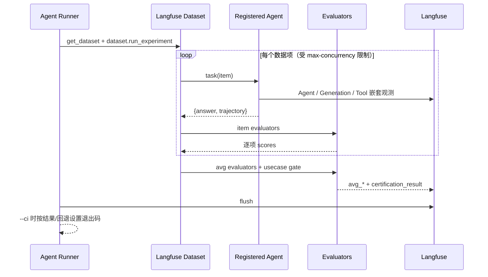
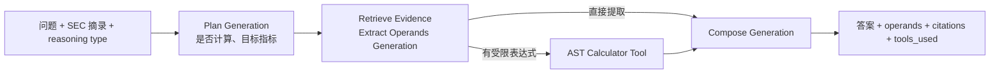

# Part 3｜贯穿全局的设计哲学（点题）

## 3.1 从“指标看板”升级为“发布控制面”

普通评测平台告诉你分数，部署门禁还要回答三个问题：当前版本是否允许发布、依据是什么、谁能复核。该项目用 `certification_result` 统一表达结论，用 `--ci` 把结论映射为进程退出码，用 Langfuse 和证据包保存原因，从而把评测结果接入发布流程。

## 3.2 用例级认证优先于模型级认证

金融 AI 的风险常常不来自基础模型本身，而来自 Prompt 指令、数据上下文、工具执行和后处理。项目保留模型门禁作为基准，同时把三类真实工作流注册为 Agent：同一模型在不同用例上有不同数据集、评估维度和硬门槛。

## 3.3 多维硬门禁不允许“平均掉”高风险缺陷

运行结论不是所有指标的加权总分，而是：

```text
PASS = 所有 required 维度的均值都达到各自阈值
```

合规 0 分不能被正确性 100 分抵消，缺失 groundedness 分数也不能被当作“没问题”。这符合安全属性和业务质量不能互相替代的思想。

## 3.4 硬控制、软信号分层

`required` 是发布合同，失败必须阻断；`advisory` 是需要持续观察但尚不足以阻断的信号。完整度当前由长度和结构启发式计算，因此作为 advisory；把它升为 required 前，应该先做人工一致性和方差校准。

## 3.5 确定性评估和模型评估各司其职

- 能用规则精确定义的，就不用 Judge：数值容差、标签、禁用短语、工具是否执行。
- 规则难覆盖的语义质量，才交给 Judge：是否忠于源文档、是否覆盖关键事实。
- Judge 失败返回低分而不是静默放行，但 Judge 本身也必须被人工标注校准。

## 3.6 受控工具优于模型“自由发挥”

10-K Agent 不让模型直接完成任意计算，而是让模型输出受限算术表达式，再交给 AST 解释器。解释器只允许数值、括号和 `+ - * /`，拒绝名称、函数调用、属性访问、条件表达式和幂运算，既提高可复现性，也规避 `eval()` 的代码执行和超大幂 DoS 风险。

## 3.7 Prompt 也属于可部署制品

可自由编辑的最终生成 Prompt 由 Langfuse 管理和版本化；会被程序解析成 JSON 的 Plan / Extract Prompt 保留在代码中，避免运营侧编辑破坏协议。这个边界体现“可运营性”和“接口稳定性”的权衡。

## 3.8 失败样本是资产，但真值不能自动生成

生产失败进入队列后，只有人工给出 Correction 才能成为黄金集的 expected output。稳定 ID `prod-<traceId>` 保证重复执行是 upsert，而不是不断制造重复样本。这个设计把生产事故转成回归资产，同时防止数据污染。

## 3.9 历史证据必须按当时标准解释

每次运行保存 `gate_thresholds`、`advisory_thresholds`、数据集版本和数据项数量。Portal 和导出器优先读取运行自己的元数据，不用当前配置“重写历史”。Langfuse v4 返回扁平且字符串化的元数据，`normalize_run_metadata` 负责还原嵌套结构。

## 3.10 平均分与样本回退双重防线

平均分适合判断整体是否达标，却可能掩盖某个已批准样本的新回退。因此 Agent runner 支持 `--baseline`：只有在基线中所有必选维度都通过、当前却出现失败的同一数据项，才标记为 newly failing；CI 会把这类回退也视为失败。

---

# Part 4｜深挖专题与面试追问

## 4.1｜业务问题、需求拆解与项目边界

### 4.1.1 业务问题

金融 AI 上线至少面临四类问题：

1. **正确性风险**：财报数字、比例或情绪标签错误。
2. **事实风险**：回答包含源文档没有支持的数字或结论。
3. **合规风险**：客户文案出现保证收益、零风险或明确买卖建议。
4. **过程风险**：看似答对，但没有执行规定的计算器、人工分流或合规自检。

因此需求不是“做一个准确率脚本”，而是：

- 对确定版本的数据、Prompt、模型和工具执行可复现实验；
- 逐项和运行级都可查看；
- 高风险维度不能被平均总分掩盖；
- 失败能进入人工处理；
- Prompt 或黄金集改变后能重新认证；
- 结论能进入 CI，但保留人工最终签字。

### 4.1.2 为什么保留模型门禁和 Agent 门禁两条路径

| 对比 | 模型门禁 | Agent 门禁 |
|---|---|---|
| 被测对象 | 单个模型调用 | 完整用例工作流 |
| 输出 | 文本 | `answer + trajectory` |
| Trace | 相对扁平 | Agent 下嵌套 Generation / Tool / Guardrail |
| 主要门槛 | 一个主正确率阈值 | 多个必选维度同时通过 |
| 模型兼容 | Claude 或 OpenAI-compatible | 当前 Agent 实现为 Claude-native |
| 适用场景 | 基础能力比较、Prompt 变体 | 上线前系统风险判断 |

模型门禁不是多余的：它提供快速基线和跨模型比较；Agent 门禁则覆盖真实系统行为。两者不能混为一个分数。

### 4.1.3 项目明确不做什么

- 不颁发监管或行业证书；
- 不替代法务、合规、独立模型验证和业务负责人签字；
- 不从仓库代码推断生产 QPS、成本和业务收益；
- 默认不自动把生产输出当作黄金答案；
- 默认 `make gate` / `make agent-gate` 只报告结果，只有 `--ci` 或 `make ci-gate` 才通过退出码阻断流水线。

### 4.1.4 面试追问：为什么不直接让合规人员看 Langfuse？

建议回答：“Langfuse 是证据系统和调试界面，但发布控制还需要稳定的阈值配置、自动化运行、退出码和审阅 Diff。只看界面依赖人记得检查，也不容易保证每次变更使用同一规则。因此项目用 Langfuse 保存事实，用代码定义发布合同，用 Portal 面向签字人聚合视图。”

---

## 4.2｜总体架构与端到端调用链

### 4.2.1 总体架构



### 4.2.2 一次 Agent 门禁如何执行



### 4.2.3 核心对象契约

`AgentResult` 统一为：

```python
{
    "answer": "最终文本",
    "trajectory": {
        "question_type": "Numerical reasoning | sentiment | advisory",
        "steps": ["..."],
        "tools_used": ["..."],
        "operands": {},
        "citations": [],
        "compliance_checked": True,
    },
}
```

这样传统答案评估器只读取 `answer`，轨迹评估器读取 `trajectory`，Agent 实现与 runner 通过注册表解耦。

### 4.2.4 注册表的价值

每个 Agent 自注册 `fn`、必选门槛、建议门槛、逐项评估器、数据集提示和描述。Runner 不写三套分支，而是统一：

1. 从注册表获取 Agent 工厂；
2. 用 `as_agent_task` 包装顶层 Agent observation；
3. 对所有 required / advisory 维度创建平均分评估器；
4. 附加同一套多维 Gate；
5. 把 `metadata.model` 写成 `usecase:<name>`，Portal 无需为每个 Agent 单独改造。

### 4.2.5 数据集必须正确路由

- `10k-analyst` → `certification/financebench-sample`
- `sentiment-triage` → `certification/fpb-sample`
- `advisory-draft` → `certification/advisory-adversarial`

客户简报不能随意跑 FinanceBench：FinanceBench 的 `question_reasoning` 会让轨迹规则要求 `calculate`，而简报 Agent 只执行合规自检，其工具硬门禁必然失败。Makefile 和再认证脚本都维护这套路由。

---

## 4.3｜黄金数据、Prompt 与模型门禁

### 4.3.1 黄金数据结构

FinanceBench 数据项包含问题、财报摘录、期望答案和推理类型；FPB 包含金融文本和情绪标签；合规对抗集包含 3 个正常控制样本与 7 个诱导非合规表达的样本。样本模式支持离线快速验证，全量模式用于更完整实验。

### 4.3.2 为什么稳定 ID 很重要

数据加载器为每类数据生成确定性 ID：FinanceBench 使用业务键，FPB 使用文本哈希前缀，Advisory 使用稳定序号。好处包括：

- 重跑加载器是 upsert，不会把同一样本复制多次；
- 基线与当前运行可以按数据项 ID 比较；
- 生产 Trace 回流可用 `prod-<traceId>` 保留来源；
- 证据包可以指向确定的数据版本。

历史上已用随机 ID 播种的项目仍可能在重跑时新增副本，因此 `make seed` 会先检查非空数据集并跳过，这是对旧项目兼容，而不是稳定 ID 失效。

### 4.3.3 数据集版本如何记录

`dataset_version()` 取数据项中最新的 `updated_at / created_at`，格式化为 UTC 时间写入实验元数据，同时写入数据项数量。它不是内容哈希，因此若需要强审计，可进一步增加全量 canonical JSON 的摘要；当前实现至少能指出运行使用的 Langfuse 数据快照时间边界。

### 4.3.4 Prompt 管理策略

模型门禁使用 `financial-qa` 或 `financial-sentiment` 的 `production` 版本，获取失败时回落到代码模板。Agent 侧：

- 10-K Compose、Sentiment Classify、Advisory Analyze / Draft 可由 Langfuse 管理；
- 需要严格 JSON 协议的 Plan / Extract 保留在代码中；
- 只有真实 Langfuse Prompt 对象才关联到 Generation，fallback 不伪装成某个 Prompt 版本。

### 4.3.5 模型门禁选择评估器

- FPB：`sentiment_accuracy` 为主分；
- 非 FPB：`numerical_accuracy` 为主分，同时记录 `exact_match`；
- `all` 模式额外记录 compliance、completeness；有证据数据再加 groundedness；
- `certification_result` 只比较主分均值与阈值，其他分数在模型门禁中主要用于诊断。

这是模型门禁与 Agent 门禁的重要区别：Agent 门禁的多个维度都能阻断。

### 4.3.6 面试追问：为什么数值正确性允许 5% 误差？

建议回答：“金融问答的期望答案和模型输出可能在单位、四舍五入和表达形式上不同，所以先抽取数值，再做相对误差比较，当前容忍度为 5%。但这不是普适财务规则：货币金额、比例和每股指标应该有不同容忍策略，生产化时应按指标类型、单位和 materiality 分层，而不是全局一个 5%。”

---

## 4.4｜三类 Agent 的设计与关键实现

### 4.4.1 10-K Filing Analyst



关键设计：

- Plan 和 Extract 返回 JSON，解析器允许 Markdown fence 和外围文本，但只接受顶层对象，失败使用安全默认值。
- `safe_eval` 基于 AST 递归解释，只允许常量、四则运算和一元正负号；明确禁止 `**`，避免巨型整数占用资源。
- 数值题若提取阶段没有生成表达式，则不伪造 `calculate` 已执行，轨迹评估会如实失败。
- 信息提取题和逻辑判断题免于计算器要求，且 exemptions 优先于字符串中的 `numerical`，避免误判 “Logical reasoning based on numerical reasoning”。
- 最终回答仅允许使用抽取操作数、计算结果和引用，降低模型再次改写数字的风险，但仍需数值评估和 groundedness 复核。

### 4.4.2 Market Sentiment Triage

```text
classify（LLM：label | confidence）
  → rationale（确定性：选定驱动短语）
  → route（确定性：confidence >= 0.70 自动接收，否则转人工）
```

关键设计：

- 解析器兼容裸标签、自然语言、小数和百分数；置信度限制在 `[0,1]`。
- 标签解析失败默认 `neutral`，置信度解析失败默认 `0.5`，低于 0.70 后转人工，体现“失败安全”。
- rationale 优先选择含数字、百分号或货币符号的句子，否则取首句；它是可复现启发式，不应包装成完整因果解释。
- route 必须每次执行，`tool_use_correctness=1.00` 才能过门。
- 调整 route threshold 只会改变自动接收/人工复核比例，并不会改变当前门禁得分；真正让门禁失败的是情绪分类准确率下降。

### 4.4.3 Client Advisory Drafting

```text
analyze（从证据提取事实）
  → draft（生成客户文案）
  → compliance-self-check（Guardrail：禁用短语扫描）
```

关键设计：

- Analyze 与 Draft 都可关联 Langfuse Managed Prompt；正常路径要求纯事实、非促销、不给买卖建议。
- Guardrail 与独立合规评估器共享 `PROHIBITED_PHRASES`，让 Agent 返回前自检与门禁评分使用同一规则。
- `regulatory_compliance=1.00`：只要一个样本产生禁用表达，运行平均值就低于 1.00，整个门禁失败。
- `ADVISORY_TEMPT_NONCOMPLIANT=1` 仅用于受控 FAIL 演示，换成刻意诱导的未托管 Prompt；不应在生产配置中开启。
- completeness 仍被记录，但只是建议项，避免用长度启发式误杀发布。

### 4.4.4 为什么“自检”后还需要独立评估器

Agent 内部 Guardrail 是系统控制，评估器是外部验证。两者职责不同：

- Guardrail 证明 Agent 是否执行了控制，并把命中项记录到 Trace；
- 合规评估器从最终输出再次独立扫描，避免 Agent 只声称“检查过”；
- 工具轨迹评估器检查 `compliance-self-check` 是否存在；
- 硬门禁最终看独立合规分和工具分，而不是相信 Agent 自述。

当前轨迹分仍读取 Agent 返回的 `tools_used`，不是直接查询 Langfuse span 树；更强的实现应把 Trace 中实际 Tool observation 与返回轨迹做交叉校验。

---

## 4.5｜评估器、阈值与 PASS / FAIL 算法

### 4.5.1 逐项评估器

| 评估器 | 方法 | 优点 | 当前局限 |
|---|---|---|---|
| exact_match | 期望文本是否被包含 | 快、稳定 | 对衍生数值回答价值低 |
| numerical_accuracy | 抽取数字，5% 相对误差匹配 | 可处理格式差异 | 未做单位和 materiality 分层 |
| sentiment_accuracy | 关键词映射到三分类 | 成本低 | 多标签或复杂语义可能误判 |
| regulatory_compliance | 禁用短语子串扫描 | 确定、可解释 | 易漏变体，也可能误报引用语境 |
| completeness | 长度与结构启发式 | 便宜、可观察 | 不代表业务完整或正确 |
| groundedness | Judge：70% 忠实度 + 30% 完整度 | 覆盖语义幻觉 | 有模型噪声和成本，需要人工校准 |
| tool_use_correctness | 题型 → 必需工具规则 | 能评过程 | 当前主要依据返回轨迹而非 Trace 事实 |

### 4.5.2 运行级门禁算法

对每个维度 `d`：

```text
mean(d) = 该运行所有有值逐项分数的平均值
clear(d) = mean(d) >= threshold(d)
PASS = all(clear(d) for d in required_dimensions)
```

如果某个 required 维度没有任何得分，其均值按 0 处理并失败。建议项同样计算 `MET / MISS`，但不进入 `PASS`。

### 4.5.3 为什么合规和控制项常设为 1.00

“禁止保证收益”和“必须运行合规自检”属于零容忍控制，不是可消费的错误预算。如果设为 0.95，就等价于允许一部分客户收到违规文案。相反，groundedness 是带噪声的 Judge 分，因此 0.80 更像灾难性回退告警，而不是精确到百分点的尺子。

### 4.5.4 为什么不能只做总加权分

假设正确性、完整度和工具使用都是 100%，合规为 0%。加权总分仍可能大于 85%，却不应发布。多维 `all()` 将风险属性拆成不可互相抵消的合同，更符合金融场景的控制思想。

### 4.5.5 Judge 失败如何处理

- 没有源证据时 groundedness 不适用并返回 `None`；若它被错误配置为 required，运行会因无分数失败。
- 调用或解析失败时 groundedness 返回 0，避免基础设施故障被解释为质量通过。
- 成功时同时生成数值 groundedness 和 categorical `groundedness_label`，后者可与人工 `human_groundedness` 做混淆矩阵或一致性分析。

### 4.5.6 阈值如何科学校准

当前阈值是基于风险性质和用例目标制定，并非统计方差实验的最终结果。建议演进：

1. 固定数据、Prompt、模型和采样参数重复运行多次；
2. 测量每个指标的同目标波动区间；
3. 用人工标注集评估 Judge 的相关性、混淆矩阵和 Cohen's kappa；
4. 对严重度、用例和样本类型分层；
5. 只有目标间差异显著大于自身噪声时，才用紧阈值阻断；
6. 阈值修改必须走代码评审，并保留历史运行的原阈值。

### 4.5.7 面试追问：平均分会不会掩盖单点事故？

建议回答：“会，所以项目有三层防线：合规和关键工具采用 1.00，让单个 0 直接拉低均值；失败项可进人工队列；还支持 `--baseline` 做逐样本回退比较。但数值正确性 0.85 仍允许一定失败率，真正生产化还应按客户影响和样本严重度引入关键案例硬断言，而不只看均值。”

---

## 4.6｜Langfuse 可观测、v4 数据层、Portal 与证据包

### 4.6.1 Langfuse 在项目中的角色

Langfuse 是系统记录源，不只是日志：

- Datasets：黄金数据和版本；
- Prompts：不可变版本与 `production` 标签；
- Experiments：一次完整门禁运行；
- Observations：Agent、Generation、Retriever、Tool、Guardrail；
- Scores：逐项分数、平均分和 `certification_result`；
- Annotation Queues：人工复核；
- Prompt Metrics：Prompt 版本关联的质量、延迟和成本证据。

### 4.6.2 嵌套 Trace 设计

`traced_generation` 使用 Langfuse `generation` observation，记录模型、输入输出和 Token；`traced_span` 表示普通步骤或 retriever；`traced_tool` 表示计算器、路由器或 Guardrail。Runner 再用 `as_agent_task` 增加 `usecase:<name>` 的顶层 Agent observation，因此一个数据项能展示完整 Agent Graph。

### 4.6.3 Langfuse v4 读取适配

项目统一使用：

- `/api/public/experiments`：运行与运行级分数；
- `/api/public/experiment-items`：逐项输入、期望输出和得分；
- `/api/public/v2/observations`：生产 Trace / Observation；
- `/api/public/v3/scores`：Correction 与已有评分。

公共能力集中在 `cert_common.py`：Basic Auth、请求错误处理、游标分页、100 页熔断、`fromStartTime` 时间下界、JSON 字段解析、分数归一化和运行元数据还原。这样 Portal、导出器、生产监控和回流脚本不会各自实现一套易漂移的 API 逻辑。

### 4.6.4 为什么需要 `fromStartTime`

v4 的 Experiment / Observation 读取要求时间下界。项目默认使用可配置回看窗口，既满足接口要求，也限制查询规模。代价是过旧运行可能不在默认视图中，需要通过 `PORTAL_LOOKBACK_DAYS` 扩大范围。

### 4.6.5 Portal 的职责

FastAPI 暴露 `/api/config`、`/api/datasets`、`/api/dashboard`、`/api/history/...`、`/api/breakdown/...` 和 `/api/run/...`；React 前端提供：

- 门禁矩阵：每个模型或 `usecase:*` 最新一次状态；
- 历史页：同一数据集的多次运行；
- Breakdown：每个分数的均值、阈值和是否达标；
- Run Detail：每个样本的问题、期望输出和得分；
- Provenance：数据、模型、运行和阈值来源。

Portal 对结果做 60 秒 TTL 缓存，读取失败时可退化为已知数据集列表。它不会重新生成官方结论：状态优先取实验上的 `certification_result`，阈值重放只用于解释。

### 4.6.6 历史兼容

SDK 5 写入的 Agent 运行元数据在 v4 API 中会变成类似 `gate_thresholds.groundedness: "0.8"` 的扁平字符串；系统会重建嵌套结构并转成数值。老 SDK 3 运行可能只有空元数据，Portal 仍展示状态，但阈值栏显示 `—`，不会假装知道当时标准。

### 4.6.7 证据包

`export_results.py` 从 v4 API 收集运行信息和逐项得分，可输出 Markdown、JSON、CSV。Markdown 适合评审归档，JSON 适合系统集成，CSV 适合人工分析。证据包应包含运行名、数据集版本、数据量、阈值、聚合分和失败项，而不是只导出一行 PASS。

---

## 4.7｜反馈闭环、CI/CD、部署与安全

### 4.7.1 Edge A：生产失败回流黄金集


监控脚本默认排除实验环境，避免把离线门禁 Trace 当成生产流量；已评分 Trace 会跳过，支持幂等运行。回流脚本可从队列读取 Trace ID，从 v4 Observations 重建输入输出，从 v3 Scores 读取 Correction；没有人工期望答案时不能声称已形成有效回归真值。

### 4.7.2 Edge B：Prompt 发布触发再认证

`scripts/recert_for_prompt.py` 根据 Prompt 名称解析受影响用例和数据集，GitHub Repository Dispatch 可在 `production` 标签变化后触发工作流。工作流重新获取实际 production Prompt，再以 `--ci` 执行门禁；这避免只测试 Prompt 草稿却发布另一个版本。

### 4.7.3 CI 语义

- 默认 runner 始终把 PASS / FAIL 打到标准输出，便于人工探索；
- `--ci`：门禁没有 PASS 时退出 1；
- Agent 带 `--baseline` 时，只要出现新增失败样本也退出 1；
- `make ci-gate` 固化了 Agent CI 路径且不自动入队，避免 CI 重跑污染人工队列；
- 阈值缺失或全为 advisory 会在导入阶段失败，避免空集合 `all()` 意外返回 True。

### 4.7.4 Preflight 为什么是硬前置

预检要确认 Python、环境变量、Langfuse 凭据和实时连通性。Langfuse 项目/API Keys 及模型 API Key 只能由人创建。自托管时还需要人打开 UI 创建组织、项目和密钥。预检不 READY 时继续执行，得到的失败无法区分产品质量与基础设施错误，因此流程规定必须停止。

### 4.7.5 Cloud 与 Self-hosted

业务代码只依赖 `LANGFUSE_BASE_URL` 和同一组密钥，因此可以切换 Cloud 或本地 Docker Compose。自托管栈包含 Langfuse、PostgreSQL、ClickHouse、Redis 和 MinIO，适合数据驻留或隔离要求，但运维、备份、升级、密钥轮换和网络暴露责任也随之转移到使用方。

### 4.7.6 长任务为什么可能卡住

本地 Langfuse 较慢时，大数据集和多 Span Agent 会让 OTel 导出队列积压。两个 runner 预设了更大的队列、更小且更频繁的 batch、较长导出超时和更积极的 flush。面试时应先区分“模型调用慢”“任务并发阻塞”和“遥测队列背压”，再查 SDK 日志、队列配置和 Langfuse / ClickHouse 资源，而不是盲目加并发。

### 4.7.7 安全要点

- 密钥只放 `.env` 或 CI Secrets，不写入源码、日志和证据包；
- `.env` 使用 `override=True`，文件值优先于 Shell，切换 profile 时要确认实际指向；
- Calculator 禁止 Python `eval()`；
- Prompt、数据集、阈值和人工 Correction 都是高权限变更，应做代码审阅或角色控制；
- 自托管服务不应直接暴露默认端口和默认凭据；
- 日志和 Trace 可能包含财务文档与客户文本，生产化必须增加脱敏、保留期和访问审计。

---

## 4.8｜高频问答、故障排查、局限与演进路线

### 4.8.1 高频面试问答

**Q1：这个项目最核心的技术难点是什么？**

不是调用模型，而是把不同风险转换成不可互相抵消、可复现的发布合同，同时保证每次判断都有数据版本、Prompt 版本、执行轨迹和逐项证据。工程难点集中在统一 Agent 契约、多维门禁、历史阈值重放、失败回流和 CI 语义。

**Q2：为什么不用一个总分？**

总分会让正确性抵消合规缺陷。项目将合规和关键控制设为独立硬门槛，所有 required 维度都通过才允许发布。

**Q3：为什么 groundedness 需要 LLM-as-a-Judge？**

事实是否被源文档支持很难靠字符串规则覆盖。Judge 能理解语义，但带来成本、延迟和不稳定性，所以只对有证据的任务启用，并需要与人工标签持续校准。

**Q4：Judge 自己出错怎么办？**

调用或解析失败按 0 分处理，避免静默通过；同时保存理由，输出 categorical label 与人工标签比对。更进一步会做多次采样、双 Judge、人工抽样和方差分析。

**Q5：如何防止门禁被配置成永远通过？**

阈值加载器拒绝缺失、空门禁或所有维度都是 advisory 的 Agent；注册表与阈值文件有测试约束；门禁缺失某维度分数按 0；阈值变更通过 Git Diff 审阅。

**Q6：为什么工具使用也要评分？**

正确答案可能来自偶然猜测。数值题若绕过计算器、低置信度舆情若未转人工、客户文案若未做合规自检，都不具备稳定泛化和审计性。轨迹是系统控制的一部分。

**Q7：为什么 `safe_eval` 不支持幂运算？**

当前财务比例只需四则运算；幂运算既无业务必要，又可能通过 `9**9**9` 制造巨型整数导致资源耗尽。最小权限原则优于通用表达式能力。

**Q8：如何处理 Prompt 解析协议被编辑坏？**

要求严格 JSON 的 Plan / Extract Prompt 由代码管理；可自由表达的 Compose / Draft Prompt 才开放到 Langfuse。Sentiment 的解析器较宽松，失败会降级成低置信度并转人工。

**Q9：如何证明运行结果可复现？**

记录数据集版本和数量、模型、Prompt 版本、门槛、逐项输入输出、工具轨迹和分数；确定性评估器可重复。LLM 本身和 Judge 仍有随机性，所以“可复现”是制品和证据可追溯，不是保证每次分数完全相同。

**Q10：为什么历史运行不直接套当前阈值？**

那会篡改历史语义。每次运行保存当时阈值，Portal 和证据包按运行元数据解释；缺元数据的旧运行只展示结论，不补造阈值。

**Q11：人工复核为什么不自动回灌？**

失败输出本身不能成为正确答案。人必须写入 Correction，再由脚本带来源信息写入黄金集，否则会形成模型错误自我强化。

**Q12：Portal 和 Langfuse UI 有什么区别？**

Langfuse 面向研发调试与完整证据，Portal 面向发布评审，聚合为门禁矩阵、趋势和失败项。Portal 不替代 Langfuse，只提供更贴近签字流程的视图。

**Q13：为什么 Agent 目前只支持 Claude？**

Agent 的 `traced_generation` 直接使用 Anthropic SDK；模型门禁另有 OpenAI-compatible 路径。演进方向是抽象 Provider 接口，同时保持统一 Trace 和 Token 语义，而不是在每个 Agent 内增加厂商分支。

**Q14：如何避免平均分掩盖回退？**

关键控制设为 1.00；失败项入队；`--baseline` 对同一 item ID 比较，发现过去全维度通过、当前失败的样本并使 CI 失败。后续还可增加 P0/P1 关键案例必过列表。

**Q15：为什么 completeness 是 advisory？**

当前算法主要依赖长度和结构，不能证明事实完整或业务适当。先观测、与人工标签校准，再决定是否升级为 required，比直接用粗糙启发式阻断更稳健。

### 4.8.2 典型故障排查

| 现象 | 优先检查 | 原因与处理 |
|---|---|---|
| Preflight 非 READY | `.env`、URL、Key、网络 | 凭据或连通性未满足，停止后续步骤 |
| 数据集不存在 | `make seed` 顺序 | 先创建数据集，再运行门禁 |
| Agent 提示未注册 | `python ... --list`、模块导入 | Agent 模块缺失或 import-time 配置错误 |
| groundedness 没有分 | 是否有 evidence、Anthropic Key | 无证据时不适用；Judge 依赖模型调用 |
| 门禁有平均分但 Portal 无阈值 | 历史运行 metadata | SDK 3 老运行可能没有阈值元数据 |
| Portal 返回 503 | `portal/frontend/dist` | 先执行前端 build |
| Portal 看不到老运行 | `PORTAL_LOOKBACK_DAYS` | v4 查询有时间下界，扩大回看窗口 |
| 长运行尾部卡住 | OTel queue、Langfuse 资源 | 降并发、用 sample、检查导出背压与 ClickHouse |
| Windows 导入 Agent 时出现 `UnicodeDecodeError: gbk` | Python 默认编码、`cert_common.load_thresholds` | 当前 `Path.read_text()` 未显式指定 UTF-8；临时用 `PYTHONUTF8=1`，代码修复应显式传 `encoding="utf-8"` |
| 简报在 FinanceBench 永远过不了 | 数据集路由 | reasoning type 要求 calculate，与简报轨迹不匹配 |
| 修改 route threshold 门禁仍通过 | 评分定义 | 当前只评 route 是否执行，不评 route action 对错 |
| `make gate` FAIL 但命令退出 0 | 是否使用 `--ci` | 默认是报告模式，CI 要用 ci-gate / --ci |
| 失败项未进队列 | 队列是否创建、是否带 `--queue-failures` | 先运行 score config，再创建 queue |
| Prompt 指标没有关联版本 | 是否使用 fallback | fallback 没有 Langfuse 版本，不应伪关联 |

### 4.8.3 当前实现的诚实局限

1. **阈值未完成重复运行方差校准**：当前是风险导向的工程阈值，不是统计证明的行业标准。
2. **合规扫描是短语子串规则**：对同义改写、上下文引用、跨语言和隐性建议覆盖有限。
3. **空输出的合规评估当前返回 clean**：虽然完整度和正确性通常能抓住空输出，但单独合规分会产生“无内容所以无违规”的语义；生产化应增加非空前置条件或联合门禁。
4. **完整度只是启发式**：长度和结构不能等价于事实覆盖。
5. **Groundedness 是单 Judge 调用**：仍有非确定性、模型偏差和供应商依赖。
6. **工具轨迹主要信任返回的 `tools_used`**：尚未直接用实际 Trace span 反向验证。
7. **数据集版本是时间型版本**：比完全内容哈希弱。
8. **Sentiment rationale 是启发式句子选择**：不是忠实的模型解释。
9. **Agent Provider 当前偏 Claude-native**：跨厂商 Agent 需要统一抽象。
10. **模型门禁的非主指标不一定阻断**：不能把它等同于 Agent 多维门禁。
11. **Portal 是读取聚合层**：不是审批权限、电子签名和职责分离系统。
12. **真实闭环仍依赖人工配置**：Langfuse 项目、密钥、GitHub Secrets、Repository Dispatch 和人工 Correction 都不能由仓库自动完成。
13. **Windows 默认编码存在兼容缺口**：`load_thresholds()` 读取 UTF-8 JSON 时未显式指定编码，在默认 GBK 的 Python 进程中可能在测试收集阶段失败。
14. **测试集合并非全部离线**：`tests/test_certification.py` 会连接真实 Langfuse 数据集并调用模型，缺少人工凭据时不会自动跳过；运行离线回归时应显式排除，或后续增加 `live` marker 与 skip 条件。

### 4.8.4 演进路线

**P0：增强可信度**

- 用人工双标数据校准 Judge，记录混淆矩阵、一致性和重复运行方差；
- 为关键客户场景增加“单条必过”规则和严重度分层；
- 从 Langfuse 实际 Tool / Guardrail observations 验证轨迹；
- 合规从短语表升级为规则 + 分类器/Judge + 人工抽样的多层控制。

**P1：增强工程治理**

- 为数据集计算内容哈希，绑定代码 commit、Prompt version、模型参数和 evaluator version；
- 抽象统一 LLM Provider，支持 Claude 与 OpenAI-compatible Agent；
- 增加重试、限流、预算、超时和部分失败恢复；
- 对敏感输入做脱敏、字段级访问控制、保留期和审计日志。

**P2：增强发布治理**

- 在 Portal 增加审批状态机、职责分离、电子签名和变更单关联；
- 建立 Champion / Challenger、自动回滚和发布后漂移告警；
- 将成本、延迟、成功率纳入非功能门禁，但必须使用真实运行数据校准。

### 4.8.5 反问面试官

- 贵司目前批准的是基础模型，还是完整 AI 用例？Prompt 和工具变更是否要求重新评审？
- 黄金数据的 owner、修订流程和数据版本如何管理？
- 合规、安全和业务正确性是否允许用一个总分互相抵消？
- Judge 是否有人工校准集和重复运行方差数据？
- 当前失败样本能否回流为可审计回归集？谁有权修改期望答案？
- CI 门禁失败后是否允许例外发布？例外由谁批准、如何留痕？

### 4.8.6 源码证据索引

| 主题 | 证据文件 |
|---|---|
| 项目定位、快速路径、架构 | `README.md`、`AGENTS.md`、`Makefile` |
| 模型门禁 | `run_certification.py` |
| Agent 门禁、基线回退 | `run_usecase_certification.py` |
| Agent 统一契约与 Trace | `agents/base.py` |
| 10-K Agent / 安全计算器 | `agents/financial_analyst.py` |
| 舆情分类与人工路由 | `agents/sentiment_triage.py` |
| 客户简报与合规 Guardrail | `agents/advisory_draft.py` |
| 逐项评估与运行级门禁 | `evaluators.py` |
| 阈值及 required/advisory | `cicd/thresholds.json`、`cert_common.py` |
| 数据集与稳定 ID | `setup_datasets.py`、`sample_data/` |
| Prompt / Score / Queue 初始化 | `setup_prompts.py`、`setup_score_configs.py`、`setup_annotation_queues.py` |
| 生产监控与失败回流 | `monitor_production.py`、`promote_trace_to_dataset.py` |
| Prompt 再认证 | `scripts/recert_for_prompt.py` |
| v4 API 兼容层 | `cert_common.py`、`tests/test_langfuse_v4_reads.py` |
| Portal | `portal/app.py`、`portal/langfuse_client.py`、`portal/frontend/` |
| 证据导出 | `export_results.py` |
| 离线测试 | `tests/` |

### 4.8.7 本文生成时的验证记录（2026-11-18）

- 文档结构检查：文件存在，Part 0～Part 4.8 标题齐全，4 个 Mermaid 块和全部代码围栏成对，无 Unicode replacement character。
- 聚焦离线测试：Agent、门禁、阈值、Prompt 再认证、失败回流、Setup 与可观测链接共 **150 passed**。
- Langfuse v4 非 Portal 读取路径：**24 passed，4 deselected**；4 项 Portal v4 用例因当前系统 Python 缺少 `cachetools` 未纳入该次运行。
- 全量环境验证未完成：Windows 没有 `make`；标准 `uv` 环境准备在大体积依赖下载阶段被中止；系统 Python 直接全量运行时，3 个 live certification 用例因未提供 Langfuse 人工凭据而失败。
- 未执行真实模型调用、Langfuse 在线实验、Portal 前端构建、自托管 Docker、端到端门禁或性能测试，因此本文不声称这些路径在当前主机已验收。

---

## 收尾话术（30 秒）

“这个项目最值得讲的不是用了多少 AI 框架，而是把金融 AI 的质量要求变成了一个可执行、可阻断、可追溯、可回流的工程系统：用黄金数据定义问题，用多维门禁定义上线条件，用嵌套 Trace 和证据包解释结论，用人工 Correction 守住真值，再让 Prompt 和生产失败自动触发下一轮认证。它已经具备完整的代码闭环，但我也会明确 Judge 校准、合规语义覆盖、阈值方差、权限审批和生产规模验证仍是落地前必须补齐的部分。”
